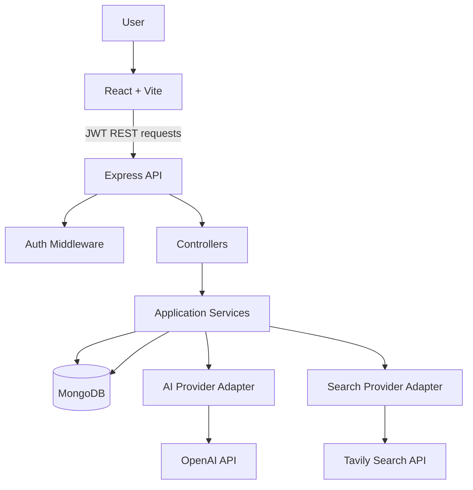
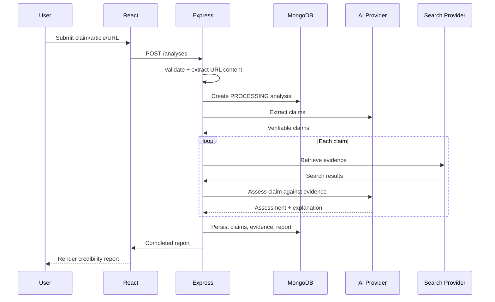

# TrustLens Architecture

## Analysis sequence

## Data model
- User 1 → many Analysis
- Analysis 1 → many embedded Claims
- Claim 1 → many embedded Evidence records
- TrustedSource is a separate registry used to annotate matching source domains.

Evidence is embedded in each claim because the primary read pattern is retrieving a report with all its claim evidence. Trusted source definitions remain separate and are matched by normalized domain.
